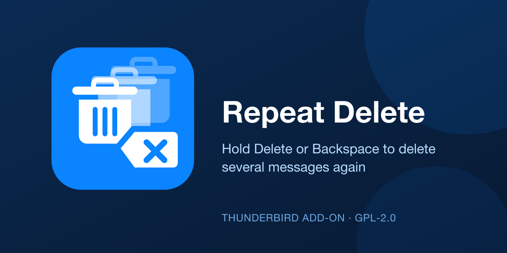

A tiny Thunderbird add-on that **restores deleting several messages by holding
down the Delete or Backspace key**, as it worked before Thunderbird 128.

Why
===

Since Thunderbird 128 (`bug 1675212
<https://bugzilla.mozilla.org/show_bug.cgi?id=1675212>`_), key auto-repeat is
deliberately ignored for Delete and Backspace in the message list, to avoid
deleting messages by accident. The developers declined to bring the old
behaviour back (`bug 1911946
<https://bugzilla.mozilla.org/show_bug.cgi?id=1911946>`_). This add-on does.

Features
========

- Hold **Delete** or **Backspace** in the message list to delete messages one
  after the other, as before.
- Works in every mail tab and window, including ones opened later.
- Every other key keeps its normal behaviour.
- Disabling or removing the add-on restores Thunderbird's behaviour
  immediately, no restart needed.

Compatibility
=============

Thunderbird **140.x** (developed and tested on 140.17.0 ESR). Thunderbird
requires Experiment add-ons to declare a maximum version, so each new major
release needs a (usually trivial) compatibility update.

Installation
============

1. Download ``repeat-delete.xpi`` from the
   `Releases page <https://github.com/netitbe/thunderbird-repeat-delete/releases>`_,
   or build it yourself (see `Building`_).
2. In Thunderbird: **Add-ons and Themes** → gear icon → **Install Add-on From
   File…** and select the XPI.
3. If Thunderbird refuses the unsigned add-on, open **Settings → General →
   Config Editor** and set ``xpinstall.signatures.required`` to ``false``, then
   retry.
4. Restart Thunderbird.

Usage
=====

Nothing to configure. Select a message and keep Delete or Backspace pressed.

.. warning::

   There is no safety net left: a long key press deletes as many messages as
   the key repeats. Messages go to the Trash (or are deleted according to your
   account settings), exactly as with single presses.

Permissions
===========

.. list-table::
   :header-rows: 1
   :widths: 20 80

   * - Permission
     - Why
   * - *Experiment API*
     - Thunderbird shows this as "Have full, unrestricted access to
       Thunderbird, and your computer". It is unavoidable for any Experiment,
       and required here because a regular WebExtension cannot modify
       Thunderbird's own message list.

The experiment does a single thing: it replaces one method of the message list
(see below). No network access, no file access, no reading of message content,
no stored data.

How it works
============

In ``about:3pane``, ``threadPane._onKeyPress`` calls ``preventDefault()`` on
every *repeated* Delete or Backspace key press, which cancels the delete
command. The add-on wraps that method so repeated Delete/Backspace presses are
simply ignored by it (the default action then runs), and passes every other
event to the original method. It patches the windows and tabs already open and
those created afterwards, and puts the original method back when the add-on is
disabled.

Because this relies on a Thunderbird internal, a future major release could
change it and require an update.

Building
========

.. code-block:: sh

    git clone https://github.com/netitbe/thunderbird-repeat-delete.git
    cd thunderbird-repeat-delete
    ./build.sh

Produces ``dist/repeat-delete.xpi`` (a zip with ``manifest.json`` at its root).
Requires ``zip``. Bump ``version`` in ``manifest.json`` before each release. To
regenerate the PNG icons from ``icons/icon.svg``:

.. code-block:: sh

    for s in 32 48 64 96; do rsvg-convert -w $s icons/icon.svg -o icons/icon-$s.png; done

Project layout
==============

::

    manifest.json         Add-on manifest (MV2, experiment declaration)
    background.js         Starts the experiment
    implementation.js     Experiment API: patches the message list key handler
    schema.json           Experiment API schema
    icons/                Add-on icons (SVG source + PNGs)
    build.sh              Builds the XPI

Issues
======

Bug reports and suggestions:
https://github.com/netitbe/thunderbird-repeat-delete/issues

License
=======

Copyright (c) Netitbe SPRL, Laurent Lasudry <laurent@netitbe.be>

Licensed under the GNU General Public License v2.0 only (``GPL-2.0-only``),
see the ``LICENSE`` file.
